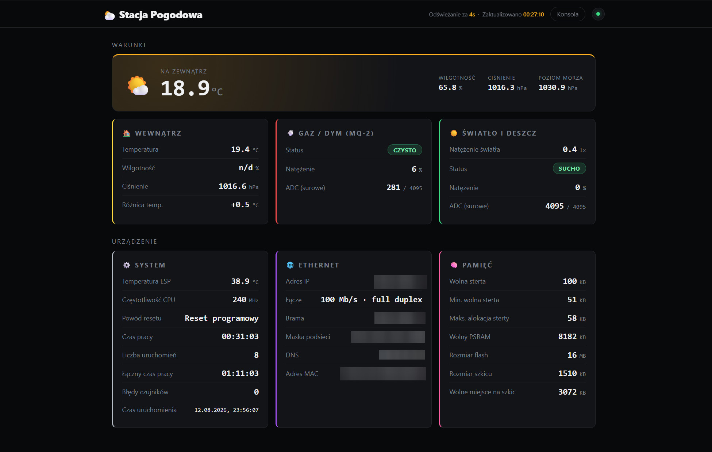

# weather-station-esp32s3

Firmware for a mini weather station on the [LILYGO T-ETH-Elite (ESP32-S3)](images/S67bc5455b73e4120871490f515895578H.avif). Reads indoor/outdoor temperature, humidity, and pressure, light, rain, and gas/smoke (MQ-2), exposes a dashboard + JSON API over HTTP, and a remote console (WebSocket, BLE, USB Serial).

Live sensor data from my station: https://beta.sefinek.net/projects/pogoda-zachodniopomorskie

Below is a screenshot of the HTTP dashboard served by the ESP32-S3.

## Hardware & sensors

- LILYGO T-ETH-Elite (ESP32-S3, W5500 Ethernet), also supports PoE which is what I use
- BME280 outside (required)
- BMP280 inside (optional, no humidity)
- BH1750 (light)
- Rain sensor
- MQ-2 (gas/smoke)

## Building

Arduino sketch (`weather-station-esp32s3.ino`) - flashed via Arduino IDE, no separate build step.

### Settings

- Board: `ESP32S3 Dev Module`
- USB CDC On Boot: `Enabled`
- Flash Size: `16MB (128Mb)`
- Partition Scheme: `16M Flash (3MB APP/9.9MB FATFS)`
- PSRAM: `OPI PSRAM`

Required libraries: `Adafruit BME280 Library`, `Adafruit BMP280 Library`, `BH1750`, `WebSockets`.

## Configuration

Copy `config.h.example` to `config.h` and fill in Wi-Fi, passwords (SHA256), pins, and station altitude. Details in [CLAUDE.md](CLAUDE.md).

## License

[MIT](LICENSE)
